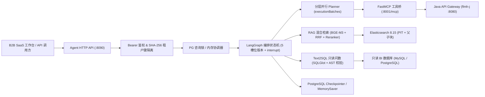

# TKi8（FLMH）出海增长 Agent 服务（Python）

基于 LangGraph 的跨境电商选品分析、运营知识混合检索（RAG）、只读 BI Text2SQL 问数与多语种带货内容生产编排服务。应用层采用清晰的领域与端口适配器分层设计，在同一进程内同时暴露 HTTP Agent API（`8090`）与 FastMCP 工具服务（`8001`），与 Java 微服务平台 [`flmh-j`](https://github.com/lboverfys/flmh-j) 协同完成从机会洞察到内容交付的完整闭环。

---

## 核心技术栈

| 分类 | 技术选型 |
| --- | --- |
| **运行时与 Web 服务** | Python 3.12+、Starlette、Uvicorn、Pydantic v2、HTTPX（异步） |
| **Agent 与工具协议** | LangGraph 1.2（状态机、`interrupt()` 人工确认与持久化 Checkpointer）、MCP / FastMCP 1.30 |
| **RAG 与评测** | Elasticsearch 8.15（稠密 + 稀疏检索）、BGE-M3、BGE-Reranker、RRF 融合与父块回填 |
| **BI Text2SQL** | SQLGlot（AST 只读解析与改写）、`psycopg` / `asyncpg`（PostgreSQL）、`aiomysql`（MySQL） |
| **状态持久化与观测** | `langgraph-checkpoint-postgres`（PostgreSQL 16 + `pg_advisory_lock`）、Langfuse、LangChain |

---

## 系统架构



---

## 核心功能

- **有状态长流程编排与丢回执幂等自愈**：生产任务的报价核算与确认使用 LangGraph `interrupt()` 挂起等待人工确认；启用 PostgreSQL Checkpointer 与 `durability="sync"` 同步落盘，并以 `quote_id` 作为建单 `Idempotency-Key` 配合 `SHA-256(user_id, run_id)` 线程隔离与 PostgreSQL 咨询锁，解决进程重启、并发提交及“Java 已建单但回执丢失”崩溃后的零重单恢复。
- **跨工具依赖分层并行 Planner**：将商品目录、榜单、30/90 天趋势、关联达人与类目解析封装为标准化 MCP 工具；Planner 先对查询、参数与上下游引用做结构化校验，按有向依赖关系输出分层并发批次 `executionBatches`，独立隔离 RAG 前置检索与只读 BI 路径。
- **五槽位版本化上下文控制**：独立维护 `product`、`region`、`product_max_price`、`budget_max` 与 `target_language` 五个带版本号的槽位；当用户仅变更语种或预算时，精确使受影响的文案/报价节点失效并复用既有选品与知识证据，保留全链路跨轮核心约束。
- **RAG 混合检索与自动化评测体系**：支持 BGE-M3 稠密/稀疏双路召回、倒数排序融合（RRF）、BGE-Reranker 重排与父文档块回填；内置结构化语料清单（`operations-v3` 含多父块跨段题与拒答候选集）以及同 PIT 消融对比与拒答评测 CLI。
- **只读 Text2SQL 与安全边界校验**：通过 SQLGlot 进行 AST 级别只读白名单校验，按登录角色绑定可访问表清单，在只读事务中下发超时限制与最大返回行数封顶，提供独立 `/v1/bi/validate` 校验接口，支持 `SQL_DIALECT` 切换 MySQL / PostgreSQL。
- **成稿转图生视频平滑交接**：通过 `/v1/agent/runs/{runId}/handoff-media` 直接衔接同一任务的确认成稿与商品上下文创建下游媒体/DAG 生产任务，保留来源链路摘要与摘要指纹。

---

## 项目结构

```text
flmh-p/
├── main.py                         # 标准单进程双端口启动入口（Agent API :8090 + MCP :8001）
├── pyproject.toml                  # 依赖声明、可选持久化/可观测扩展及脚本入口
├── requirements.txt                # 本地可编辑安装索引（-e .）
├── .env.example                    # 环境变量与配置模板
├── flmh_agent/
│   ├── api.py                      # Starlette HTTP 接口路由定义
│   ├── bootstrap.py                # 组件装配与 Windows/Linux 异步事件循环兼容适配
│   ├── config.py                   # 配置解析与安全边界校验
│   ├── managed_settings.py         # 对接工作台系统配置中心的加密快照读取
│   ├── domain/                     # 领域模型、多语种规则、槽位版本矩阵与并行规划校验
│   ├── application/                # LangGraph 工作流、对话服务、RAG 检索、Text2SQL 与入库用例
│   ├── ports/                      # 存储、鉴权、协调锁、可观测与检索抽象端口
│   ├── adapters/
│   │   ├── inbound/                # FastMCP 工具适配、账户/资产/作品/恢复路由处理器
│   │   └── outbound/               # PostgreSQL Checkpointer、PG 咨询锁、Java 网关、ES、BGE 与只读 SQL 客户端
│   ├── rag_corpus.py               # 运营语料清单与本地回退加载
│   ├── rag_benchmark.py            # 正向与无依据拒答题集制备与冻结工具
│   └── evaluate.py / evaluate_agent.py  # RAG 检索与 Agent 规划/记忆离线评测脚本
├── examples/
│   ├── rag-evaluation/             # RAG 语料、候选评测集与拒答评测流程说明
│   ├── agent-evaluation/           # Planner 与多轮槽位记忆评测套件及运行指南
│   ├── checkpoint_receipt_loss.py  # PostgreSQL 检查点丢回执强杀注入演示工具
│   ├── cross_region_category.py    # 跨站点/类目调用示例
│   └── media_workflow.py           # 媒体工作流衔接示例
└── tests/                          # 全模块自动化单元测试（含工作流、槽位、RAG 与 Text2SQL）
```

---

## 快速开始

### 前置依赖

- **Python**: `>= 3.12`
- **协同服务**（按需）：如需体验完整跨境选品、生产下单与 SaaS 工作台，需先按 [`flmh-j`](https://github.com/lboverfys/flmh-j/blob/main/README.md) 启动 Java 网关与业务服务（`8080–8085`）及前端工作台（`8091`）。

### 1. 创建虚拟环境并安装依赖

```bash
# 创建并激活虚拟环境
python -m venv .venv
# Linux / macOS: source .venv/bin/activate
# Windows PowerShell: .\.venv\Scripts\Activate.ps1

# 安装基础核心依赖
pip install -e .

# 按需安装 PostgreSQL 检查点、MySQL BI 只读驱动与 Langfuse 可观测扩展
pip install -e ".[postgres,mysql,observability]"
```

### 2. 配置环境变量

```bash
cp .env.example .env
```

- **本地零外部依赖开发模式**：保留 `.env.example` 默认值即可（`PLANNER_BACKEND=rules`、`CHECKPOINTER_BACKEND=memory`、`RAG_LOCAL_CORPUS_FALLBACK` 默认关闭）；如未配置外部 Elasticsearch 且需本地语料演示，可显式设置 `RAG_LOCAL_CORPUS_FALLBACK=true`。
- **生产持久化与检索模式**：按需填入 `CHECKPOINTER_BACKEND=postgres`、`POSTGRES_CHECKPOINTER_URI`、`POSTGRES_CHECKPOINT_SETUP=true`、OpenAI 兼容网关配置、`BGE_M3_*` / `BGE_RERANKER_*`、`ELASTICSEARCH_*`、`BI_DATABASE_URI` 及 `JAVA_GATEWAY_API_KEY`（与 Java 端 `FLMH_SERVICE_API_KEY` 保持一致）。

### 3. 启动服务

`main.py` 为标准统一入口，单进程同时拉起 Agent API（`127.0.0.1:8090`）与 FastMCP 工具服务（`127.0.0.1:8001/mcp`）：

```bash
# 仅做配置与端口绑定预检
python main.py --verify-only

# 正式启动服务（在控制台输入 stop 或按 Ctrl+C 安全退出）
python main.py
```

### 4. 核心接口与交互示例

| 接口路径 | 用途说明 |
| --- | --- |
| `GET /health/ready` | 检查服务就绪状态及 Checkpointer 后端类型 |
| `POST /v1/agent/runs` | 提交自然语言选品/分析/多语种生产需求，支持报价确认前 `awaiting_confirmation` 中断 |
| `POST /v1/agent/runs/{runId}/confirmation` | 确认（或拒绝）已核算报价单并触发下游内容下单 |
| `POST /v1/agent/runs/{runId}/retry` | 进程故障或网络丢回执后的断点幂等恢复执行 |
| `POST /v1/agent/runs/{runId}/handoff-media` | 基于已生成文本任务快捷转起图片/视频工作流 |
| `POST /v1/rag/search` | 执行运营知识混合检索并获取命中文档与父块证据 |
| `POST /v1/bi/queries` / `POST /v1/bi/validate` | 自然语言只读 BI 问数与 SQL AST 安全白名单校验 |

常用演示输入示例：
- `查美国商品榜单前3名`（验证榜单接口路由与评分版本保留）
- `分析美国露营灯的近30天趋势和关联达人数据`（验证分层并行 MCP 调用）
- `在印尼帮我挑选防晒精华并生成 id-ID 印尼语带货口播脚本，预算 20`（验证语种槽位解析、报价拦截中断与确认下单）

---

## 测试与评测

```bash
# 运行全部单元测试
python -B -m unittest discover -s tests

# 运行自带离线脚本化 RAG 评测示例
python -B -m flmh_agent.evaluate \
  --judgments examples/rag-evaluation/judgments.json \
  --run examples/rag-evaluation/scripted-ranking.json
```

更多专项测试与联调工具详见仓库内置文档：
- **RAG 语料消融与无依据拒答评测规范**：[examples/rag-evaluation/README.md](examples/rag-evaluation/README.md)
- **Agent Planner 并行轮次与多轮槽位记忆评测规范**：[examples/agent-evaluation/README.md](examples/agent-evaluation/README.md)
- **PostgreSQL 丢回执故障注入测试工具**：[examples/checkpoint_receipt_loss.py](examples/checkpoint_receipt_loss.py)

---

## 关键环境变量参考

完整参数与默认值见 [.env.example](.env.example)，核心分组如下：

| 分组 | 关键变量 | 说明 |
| --- | --- | --- |
| **服务与安全** | `AGENT_HTTP_HOST`、`AGENT_HTTP_PORT`、`MCP_HTTP_PORT`、`AGENT_TRUSTED_PROXY_CIDRS`、`JAVA_GATEWAY_API_KEY` | 控制监听端口、可信代理白名单（仅信任带内部密钥的 `X-Flmh-Client-IP`）与网关密钥 |
| **规划与模型** | `PLANNER_BACKEND`、`MODEL_GATEWAY_URL`、`AGENT_DEFAULT_REGION`、`AGENT_DEFAULT_LANGUAGE` | 规划后端（`rules` 或接入模型网关）及站点默认语种映射 |
| **检查点持久化** | `CHECKPOINTER_BACKEND`、`POSTGRES_CHECKPOINTER_URI`、`POSTGRES_CHECKPOINT_SETUP` | 切换 `memory` 与 `postgres`（PostgreSQL 16 异步 Checkpointer 与建表控制） |
| **RAG 检索** | `ELASTICSEARCH_URL`、`ELASTICSEARCH_INDEX`、`BGE_M3_URL`、`BGE_RERANKER_URL`、`RAG_LOCAL_CORPUS_FALLBACK` | 向量/稀疏检索与重排后端地址及本地语料回退开关 |
| **只读 BI 问数** | `BI_DATABASE_URI`、`SQL_DIALECT`、`SQL_MAX_ROWS`、`SQL_TIMEOUT_MS`、`BI_SQL_ROLE_TABLES_JSON` | 隔离只读数据库连接、方言（`mysql`/`postgresql`）、行数/超时上限与角色表白名单 |
| **配置中心 & 观测** | `FLMH_SETTINGS_DIR`、`FLMH_SETTINGS_MASTER_KEY`、`LANGFUSE_HOST` | 共享加密配置中心目录密钥及 Langfuse 全链路 Trace 配置 |

---

## 关联项目与文档

- **Java 微服务与前端仓库**：[`flmh-j`](https://github.com/lboverfys/flmh-j/blob/main/README.md) · [B2B SaaS 前端工作台](https://github.com/lboverfys/flmh-j/blob/main/frontend/README.md)
- **架构与验收资料**：[核心架构与关键技术设计](https://github.com/lboverfys/flmh-j/blob/main/docs/interview.md) · [交付基线说明](https://github.com/lboverfys/flmh-j/blob/main/docs/delivery.md) · [真实中间件联调与压测验收规程](https://github.com/lboverfys/flmh-j/blob/main/docs/manual-evidence.md)
